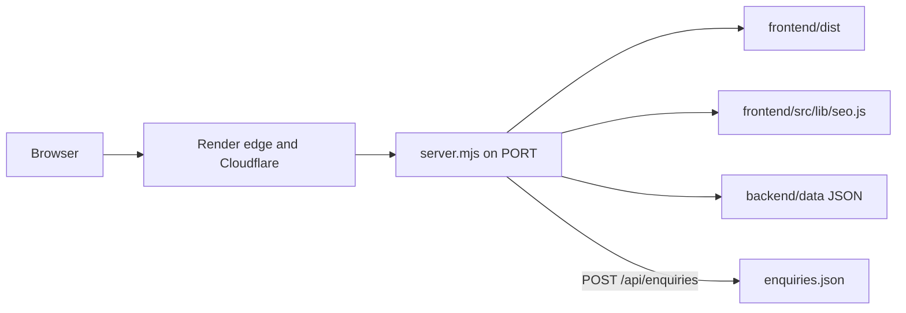

# Architecture audit

## Confirmed stack

| Layer | What the repository and live site show |
| --- | --- |
| Public site | React 19 single-page app, built by Vite 8, styled with Tailwind CSS 4 |
| Routing | React Router 7 in the browser. English paths have no prefix. Gujarati uses `/gu` |
| Production process | Node.js 22. `package.json` engines `22.x`. `render.yaml` sets `NODE_VERSION` to `22.14.0`. `frontend/package.json` allows `>=20.19.0 <23` |
| Production entry | `node server.mjs` via `yarn start` / `npm start` |
| HTTP framework | Node’s built-in `http` module. Not Express, Next.js, or Django |
| Data | JSON files. No PostgreSQL, MySQL, SQLite, or MongoDB process |
| Local-only API | FastAPI on Uvicorn, Python 3.10 or newer. CI uses 3.12. Started by `run.sh` on `127.0.0.1:8001` |
| Package managers | Root `postinstall` runs `npm ci` inside `frontend` using `frontend/package-lock.json`. Render’s build command is `yarn`, which triggers that postinstall. Root `yarn.lock` contains no packages |
| Auth | None |
| Background work | None |
| Email delivery | None. The form stores a record. It does not send mail |
| Uploads | None. Menu images are files shipped with the site |

The live response header `x-render-origin-server: Render` and the security-header set match `server.mjs`. That supports the conclusion that the public site is this Node program. The Render dashboard itself was not opened, so plan size, disk, and environment variables on the Render account are **Not Verified**.

## Request flow

1. The browser requests a URL on `chiransh-foods.onrender.com`.
2. HTTP is redirected to HTTPS at the edge. A direct `http://` request on 28 October 2026 returned `301` to the HTTPS URL. The application itself does not contain that redirect.
3. `server.mjs` listens on `process.env.PORT` or `10000`, on `0.0.0.0` (lines 14–15 and 372).
4. Paths under `/api` are handled in process. Products and settings are read from `backend/data`, with a small memory cache keyed by file modification time (lines 41–49).
5. `/robots.txt` and `/sitemap.xml` are generated from the same data (lines 340–348). The files in `frontend/public/` are not what the live server returns for those two URLs.
6. Other GET and HEAD requests are files from `frontend/dist`. HTML responses are rewritten with a title, description, canonical URL, hreflang, Open Graph tags, and JSON-LD (`applySeoToHtml`). Unknown HTML routes return status 404 with the app shell.
7. The browser then runs the React app, which calls `/api/products` and `/api/settings` on the same origin unless `VITE_BACKEND_URL` was set at build time (`frontend/src/lib/site.js` lines 6–7). Production should leave that variable empty.
8. A contact form POST goes to `/api/enquiries`. The production server requires JSON, same-origin, and a rate limit, then validates with `frontend/src/lib/enquiry.js` and appends one JSON object.

Local development is different. `run.sh` starts Vite on port 3000 and proxies `/api` to the FastAPI mock. Do not deploy that pair.

## API surface

Production (`server.mjs`):

| Method | Path | Auth | Behaviour |
| --- | --- | --- | --- |
| GET, HEAD | `/api`, `/api/` | None | Status JSON |
| GET, HEAD | `/api/health` | None | `{ "status": "ok" }`. Render health check |
| GET, HEAD | `/api/products` | None | Sorted products, cache 60 seconds |
| GET, HEAD | `/api/products/{slug}` | None | One product, or 404 |
| GET, HEAD | `/api/settings` | None | Public site settings |
| POST | `/api/enquiries` | None | Validated write, then 201 |
| OPTIONS | `/api/*` | None | 204, no CORS allow-origin header is set |
| Other `/api` | — | None | 404 JSON |
| GET, HEAD | pages and assets | None | Static file or SEO HTML |
| Other methods on pages | — | None | 405 |

There is no login, session, or role. Settings include the public phone number, WhatsApp number, service areas, hours, social profile URLs, and the FSSAI licence number. Email, map link, analytics IDs, and online-ordering URLs are null.

## Environment variables

| Name | Where | Production meaning |
| --- | --- | --- |
| `PORT` | `server.mjs` line 14 | Assigned by Render and by Hostinger Node hosting. Do not hard-code a public port |
| `NODE_VERSION` | `render.yaml` | Render only. On Hostinger, select Node 22 in the panel |
| `NODE_ENV` | `package.json` `postinstall` | Forced to `development` for the frontend `npm ci` so Vite is installed. Overriding the whole build to production before that script can skip devDependencies if the script is bypassed |
| `VITE_BACKEND_URL` | `frontend/src/lib/site.js` | Optional. Empty means same-origin `/api`. Leave unset in production |
| `API_PROXY_TARGET` | `frontend/vite.config.js` | Dev proxy only |
| `PYTHON` | `run.sh` | Local only |

No secret environment variables are referenced. `python-dotenv` is pinned in `requirements.txt` and is not called by application code.

## Render build and start

From `render.yaml` lines 11–16 and root `package.json` lines 8–11:

- Build: `yarn`
- That install runs `postinstall`: `npm ci` in `frontend`, then `npm run build` in `frontend`
- Start: `yarn start` → `node server.mjs`
- Health: `/api/health`
- Auto-deploy on commit to `main`

Hostinger does not read `render.yaml`. The same commands have to be entered as Node.js app settings. See [deployment-runbook.md](deployment-runbook.md).

## What cannot be hosted as static files

The built React files in `frontend/dist` are not sufficient.

- SEO tags for each URL are injected by `server.mjs`. `vite preview` does not do this. The README states that limitation.
- `/api/*` exists only in `server.mjs` or the local FastAPI mock.
- The enquiry write needs a running process and a writable file.
- `/sitemap.xml` on the live site is generated and currently lists all 22 dishes. The committed static sitemap does not.

A Hostinger “Vite / static” preset would drop those behaviours. Finding F-02.

## Runtime versions

| Component | Constraint | Risk |
| --- | --- | --- |
| Node | 22.x in production; frontend allows 20.19 up to but not including 23 | Hostinger documents 18, 20, 22, and 24. Choose 22 |
| Python | Not used in production. Local 3.10+. CI 3.12. Requirements comment says 3.12 | Do not choose a VPS only to install Python |
| Database | None | MySQL on Hostinger web hosting is unused. PostgreSQL is a VPS feature and is unused |

## External services

| Service | Use |
| --- | --- |
| Render | Current host of the Node process |
| Cloudflare | In front of Render, from the live `server: cloudflare` header. Account ownership was not verified |
| Instagram, Facebook, YouTube | Public profile links in settings. No API calls |
| WhatsApp and telephone | `wa.me` and `tel:` links in the browser. No WhatsApp Business API |
| Google Analytics, Search Console, Meta pixel | Fields exist and are null. No snippet is installed |

## Scheduled work and media

No cron, queue, or WebSocket server is implemented. Hostinger’s lack of inbound WebSockets and always-on workers does not block this application.

Uploaded media does not exist. Images are part of the Git repository and the frontend build. Cache headers: hashed `/assets/` for one year; images and fonts for one day with revalidation (`server.mjs` lines 275–282).

## Development-only behaviour that must not ship

- FastAPI `allow_origins=["*"]` (`backend/server.py` line 34).
- Vite dev server and the proxy to port 8001.
- Playwright scripts.
- In-memory rate limits reset on process restart. That is also true in production and is acceptable for this form.
