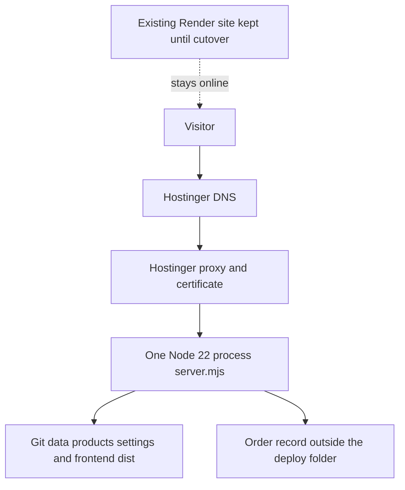

# Deployment architecture

This is a design. It has not been applied.

## Topology

Until you approve cutover, visitors keep using Render. The Hostinger app is reached by its temporary preview hostname only.

## Host and system

| Item | Choice |
| --- | --- |
| Plan | Hostinger Web Hosting Unlimited |
| Runtime | Node.js 22, selected in hPanel |
| OS access | None. Do not plan on apt, systemd, or a custom nginx file |
| Process | One Web App. Hostinger starts `server.mjs` and restarts it after a crash. It may sleep when idle |
| Account region | Choose the closest Indian or Singapore region offered at purchase. The exact city list was **Not Verified** in this session |

Fallback topology: Hostinger DNS and mail, Render process unchanged, no second Node app.

## Names

| Hostname | Role |
| --- | --- |
| `chiranshfoods.com` | Canonical site, after you buy it and approve cutover |
| `www.chiranshfoods.com` | Redirect to the apex. Not a second Node app |
| Temporary Hostinger hostname | Staging. No public marketing |
| `chiransh-foods.onrender.com` | Current production until cutover, then a redirect if Render still allows one |

Do not deploy the Git repository onto both the apex and `www`.

## DNS sketch

Exact IP addresses must be copied from hPanel or from Render after the app exists. None are invented here.

**If the site is hosted at Hostinger**

| Record | Host | Value | Purpose |
| --- | --- | --- | --- |
| A and AAAA | `@` | The addresses hPanel shows for the website | Apex |
| CNAME or redirect | `www` | The target hPanel shows, or an hPanel redirect to the apex | One hop to the canonical host |
| TXT | `@` | Search Console value, when you create the property | Verification |
| MX, SPF, DKIM, DMARC | as hPanel email setup prints them | Only after a mailbox is created | Mail |

**If the site stays on Render**

Use the records on Render’s custom-domain screen. Do not copy an old blog post’s IP address. Hostinger must stay the DNS host so mail records are not lost. There is no existing mail on this unregistered domain.

Lower TTL to 300 seconds at least a few hours before cutover, if hPanel allows that TTL. Raise it again after the move is stable.

## Application deploy

| hPanel field | Value |
| --- | --- |
| Source | GitHub repository from `render.yaml` (`https://github.com/cdasadiya/chiransh_foods`) |
| Branch | A staging branch first. `main` only when you want production auto-deploys |
| Root directory | Repository root, where `server.mjs` and `package.json` are |
| Node.js | 22 |
| Framework | Other |
| Package manager | Yarn if the build log shows `postinstall` running. If Yarn ignores `postinstall`, switch the documented command to `npm install` and rebuild. Root `yarn.lock` has no packages |
| Build command | `yarn` or `npm install`. Both trigger `postinstall`, which runs `npm ci` and `npm run build` in `frontend/` |
| Output directory | Do not set this to `frontend/dist` as a static site |
| Entry file | `server.mjs` |
| Environment | Leave `VITE_BACKEND_URL` unset. Do not put secrets in Git. `PORT` is injected |

`server.mjs` refuses to start if `frontend/dist/index.html` is missing (lines 367–369). A failed frontend build must fail the deploy. Hostinger keeps the previous successful build if the new one fails, according to its deployment documentation.

## Data

No database is provisioned. Products and settings ship in Git.

Enquiries need a decision before cutover (F-01):

- Interim: the business keeps using WhatsApp and phone. The form is tested, and you accept that a redeploy clears the file. Export anything you care about before each deploy.
- Better: a later approved change writes the file to a path outside `hbuilds`, or inserts a row into a MySQL database created in hPanel. Connection details stay in hPanel environment variables, never in Git.

## Static files and media

`yarn` / `npm install` builds `frontend/dist`. `server.mjs` serves it and injects SEO. There is no separate object store and no upload folder.

## Proxy, process, firewall, SSH

Hostinger’s proxy terminates TLS and forwards to `PORT`. You do not edit nginx. You do not open SSH ports for this plan. Restart is the Running control in hPanel.

## TLS

Use the free certificate Hostinger issues for the hostnames attached to the plan. Turn on HTTP to HTTPS in hPanel if it is not automatic. The app already sends HSTS. Confirm the redirect before sharing the new URL.

## Logs, health, backups

- Health URL: `/api/health`
- Build and runtime logs: hPanel. They should not contain phone numbers if the current log line stays as written.
- Menu and code: Git history is the rollback.
- Hostinger daily backups are advertised on Unlimited. Test a restore of a harmless file before you rely on them for enquiries. F-10.
- Render remains the rollback site until you explicitly retire it.

## SEO and analytics at cutover

Leave `canonical_base` on the Render URL until the new name serves HTTPS. Then change it in one deploy, submit the new sitemap in Search Console, and add a redirect from the Render hostname if the Render plan allows. Details are in [seo-performance-plan.md](seo-performance-plan.md) and finding F-03.

## What is intentionally not in this design

- A second region or a load balancer.
- PostgreSQL, Redis, or a VPS.
- Running `backend/server.py` on the public internet.
- Editing `render.yaml` as part of this audit.
